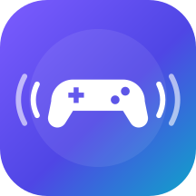
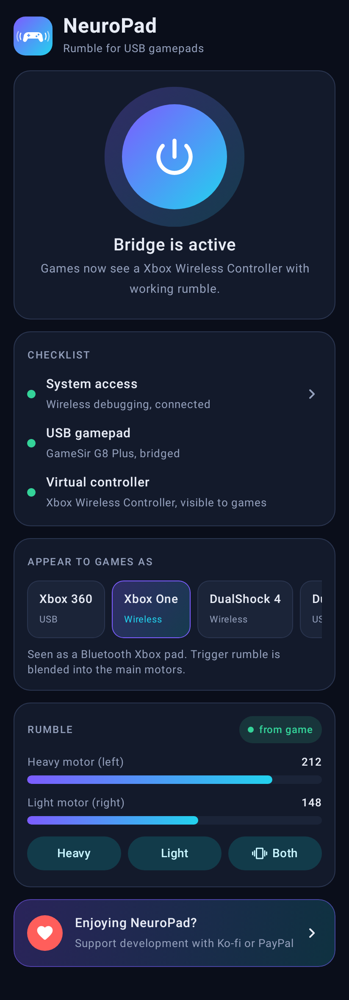
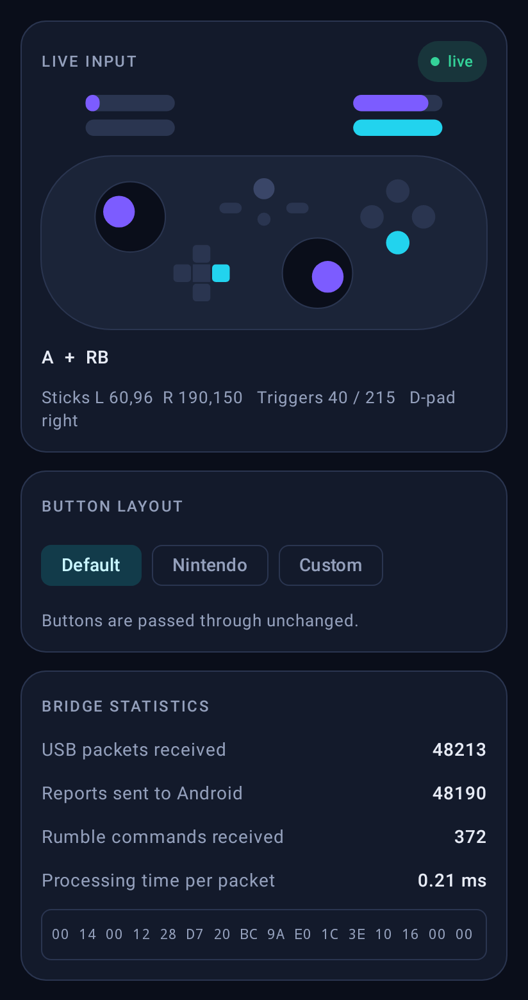
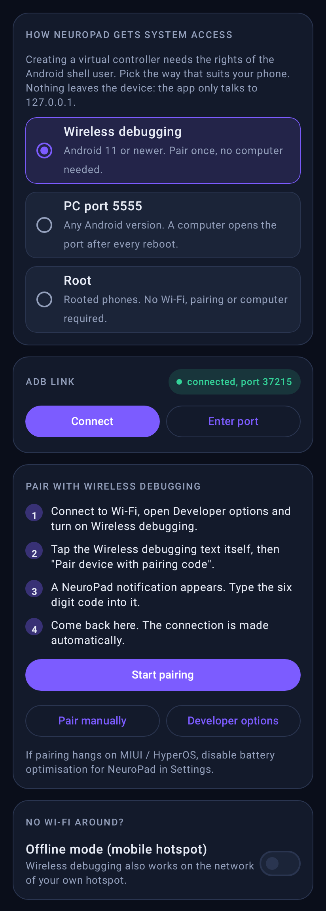
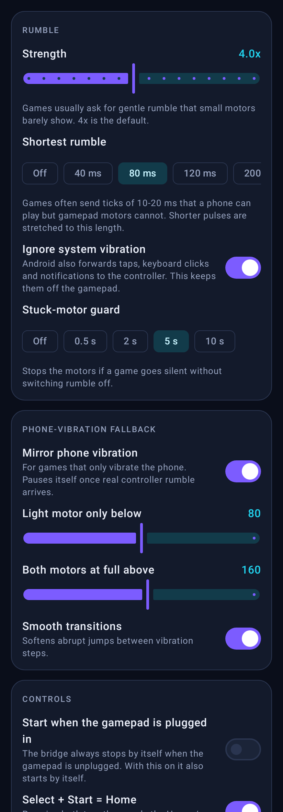
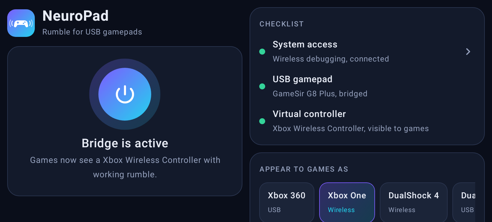
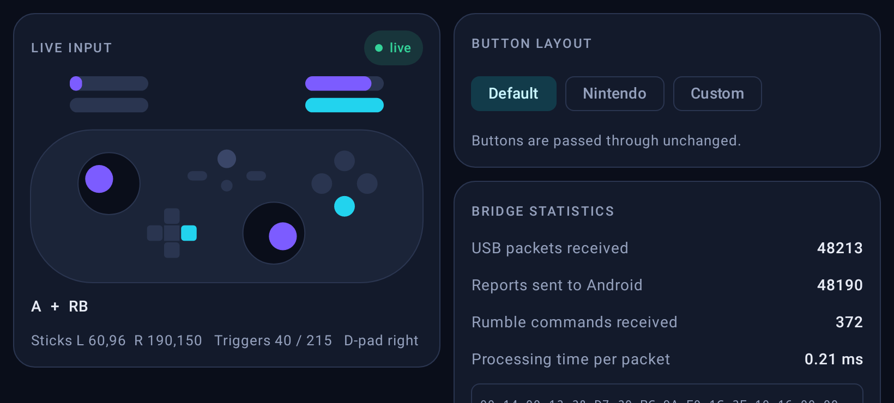

<div align="center">



# NeuroPad

**Rumble for USB gamepads on Android. No root needed.**

[](https://github.com/abdullah-amr871/NeuroPad-Virtual-GamePad-Simulation/releases)
[](https://github.com/abdullah-amr871/NeuroPad-Virtual-GamePad-Simulation/actions/workflows/android.yml)
[](#requirements)
[](#how-it-gets-system-access)
[](LICENSE)

</div>

Plug a USB-C gamepad into an Android phone and the buttons work, but the **vibration never does**: Android does not pass rumble on to most USB controllers. NeuroPad fixes that. It shows games a **virtual wireless controller** (Xbox or PlayStation) that Android fully supports, feeds it with your USB gamepad, and sends every rumble the game produces back to the motors of the real pad.

Works with **XInput (Xbox-mode) USB gamepads**. Confirmed on the **GameSir G8 Plus (MFi)** and the **Razer Kishi Ultra**.

<p align="center">
  
  
  
  
</p>

<p align="center">
  
  
</p>

## Contents

- [What it does](#what-it-does)
- [Download](#download)
- [Set up](#set-up)
- [Tested controllers](#tested-controllers)
- [Supported controllers](#supported-controllers-should-work-not-tested-yet)
- [Controller profiles](#controller-profiles)
- [How it works](#how-it-works)
- [What is new in 2.0](#what-is-new-in-20)
- [FAQ](#faq)
- [Build from source](#build-from-source)
- [License](#license)

## What it does

- **Rumble over USB.** Games vibrate the virtual controller; NeuroPad plays it on your gamepad within a few milliseconds.
- **Five controller profiles.** Xbox 360, Xbox One, Xbox Series, DualShock 4 and DualSense, with the matching button prompts in games.
- **No root.** The app talks to the phone's own ADB service on `127.0.0.1`. Root is supported too, if you have it.
- **No computer needed on Android 11+.** Pair once with Wireless debugging and the app installs its own driver.
- **Phone-vibration fallback.** For games that only vibrate the phone, that vibration is mirrored to the gamepad, split across the heavy and light motor.
- **Button remapping.** Default, Nintendo (A/B and X/Y swapped) or a fully custom layout, including back paddles.
- **Live controller view, rumble test and diagnostics** to see exactly what arrives and why something does not.
- **Follows the gamepad.** The bridge stops when the gamepad is unplugged and can start by itself when it is plugged in.
- **Made for the grip.** The app turns to landscape while a gamepad is connected and uses a two-pane layout on wide screens.
- **Quick Settings tile** to switch the bridge on and off from inside a game.

## Download

**[Download NeuroPad 2.0.2](https://github.com/abdullah-amr871/NeuroPad-Virtual-GamePad-Simulation/releases/tag/v2.0.2)** &nbsp;·&nbsp; [all releases](https://github.com/abdullah-amr871/NeuroPad-Virtual-GamePad-Simulation/releases)

| File | Use it when |
| :--- | :--- |
| `NeuroPad_2.0.2_OneClick_Installer.zip` | You have a computer nearby. Installs everything with one double-click. |
| `NeuroPad_2.0.2.apk` | You want to install straight on the phone (Android 11+, Wireless debugging). |

## Requirements

- A phone with a **64-bit ARM** processor (practically every phone since 2017) and USB host (OTG) support.
- Android 7.0 or newer. Setup without a computer needs Android 11 or newer.
- A USB gamepad that speaks **XInput** (the Xbox 360 protocol).

## Set up

### Option A: with a computer (any Android version)

1. On the phone, open **Settings > About phone** and tap **Build number** seven times. Then enable **USB debugging** in **Developer options**. On Xiaomi phones also enable *Install via USB* and *USB debugging (Security settings)*.
2. Connect the phone to the computer and tap **Allow** on the phone.
3. Extract the installer ZIP and run it:
   - **Windows:** double-click `Install_NeuroPad.bat`
   - **macOS / Linux:** `chmod +x install_neuropad.sh && ./install_neuropad.sh`
4. Unplug the phone, plug the gamepad into it, open **NeuroPad** and tap the power button.

Android closes the ADB port when the phone reboots. Afterwards, connect it again and run `Activate_Port_5555.bat` (or `activate_port_5555.sh`). Nothing is reinstalled.

### Option B: on the phone only (Android 11+)

1. Install `NeuroPad_2.0.2.apk`.
2. Open the **Connection** tab, keep **Wireless debugging** selected and tap **Start pairing**.
3. In Developer options, enable **Wireless debugging**, tap the text itself and choose **Pair device with pairing code**.
4. Type the six digit code into the NeuroPad notification.
5. Go back to NeuroPad and tap the power button.

Wireless debugging needs a Wi-Fi connection. Without one, turn on your own mobile hotspot and enable *Offline mode* in the Connection tab.

### Option C: rooted phones

Choose **Root** in the Connection tab and grant superuser access. No ADB, Wi-Fi or computer is involved.

## Tested controllers

| Controller | Status |
| :--- | :--- |
| GameSir G8 Plus (MFi) | Works, rumble included (Nothing Phone 2, Android 16) |
| Razer Kishi Ultra | Works (user report) |
| GameSir X5 Lite | Not working yet (user report). Under investigation |
| Other XInput USB gamepads | Should work. If your controller has a mode switch, set it to Xbox / XInput |

## Supported controllers (should work, not tested yet)

These controllers support XInput (Xbox mode) over USB, so NeuroPad should work with them. If yours has a mode switch, set it to **Xbox / XInput / X-mode**.

| Brand | Controllers |
| :--- | :--- |
| Microsoft | Xbox 360 wired controller, Xbox One controller, Xbox Series X/S controller, Xbox Elite Series 1 / 2 (USB cable) |
| GameSir | G8 Galileo, X2 Pro (Xbox edition), X3 Pro, X4 Aileron, T4 Pro, T4 Kaleid, Nova Lite, Cyclone 2 (wired) |
| Razer | Kishi V2 Pro, Kishi Ultra, Wolverine V2 / V2 Chroma / V3 |
| 8BitDo | Ultimate (wired / 2.4G), Pro 2, SN30 Pro (wired), Ultimate C (wired) |
| Flydigi | Vader 3 / Vader 3 Pro / Vader 4 Pro, Apex 4 (XInput mode) |
| PowerA / PDP | Wired controllers for Xbox, Rock Candy for Xbox |
| Logitech | F310, F710 (switch on the back set to **X**) |
| Others | Any USB gamepad that shows up as an Xbox 360 / Xbox One controller on a PC |

Tried NeuroPad with another controller? Tell us in [Discussions](https://github.com/abdullah-amr871/NeuroPad-Virtual-GamePad-Simulation/discussions) so it can be added here.

> **Status of 2.0:** version 2.0 is a full rewrite. It has been run on one phone so far (Nothing Phone 2, Android 16, PC port 5555 mode) with the GameSir G8 Plus. Other phones, the Wireless debugging setup and root mode have not been tried on hardware yet. If something does not work for you, please [open an issue](https://github.com/abdullah-amr871/NeuroPad-Virtual-GamePad-Simulation/issues) and attach the report from **Settings > Diagnostics > Share report**. [Version 1.0](https://github.com/abdullah-amr871/NeuroPad-Virtual-GamePad-Simulation/releases/tag/v1.0.0) stays available.

Tried another controller? An issue that says whether buttons and rumble worked helps the list grow.

## Controller profiles

| Mode | Appears as | VID:PID | Bus | Notes |
| :---: | :--- | :---: | :---: | :--- |
| 0 | Xbox 360 Controller | `045E:028E` | USB | Most compatible. The default. |
| 1 | Xbox Wireless Controller (Xbox One) | `045E:02FD` | Bluetooth | Trigger rumble is blended into the main motors. |
| 2 | Sony DualShock 4 | `054C:05C4` | Bluetooth | PlayStation prompts. |
| 3 | Sony DualSense (PS5) | `054C:0CE6` | USB | Uses the kernel's `hid-playstation` driver where present. |
| 4 | Xbox Series X\|S Controller | `045E:0B13` | Bluetooth | Like mode 1, with the newer product ID. |

If a game shows no rumble with one profile, try another: which profiles expose a vibrator depends on the HID drivers in your phone's kernel.

## How it works

```
 USB gamepad                NeuroPad app                   Android
 -----------               ---------------               -----------
   buttons  --- XInput -->  UsbGamepadManager
                            XInputParser
                            ReportBuilder  --- JSON --->  uinput_proto  --> /dev/uhid --> kernel HID driver --> games
                                                          (shell user)
   motors   <-- rumble ---  RumbleParser   <-- JSON ----  uinput_proto  <-- output reports <-- game rumble
```

1. The app claims the gamepad's XInput interface through the USB host API. That also detaches the kernel's own driver, so games do not see the pad twice.
2. A small native program, [`uinput_proto`](daemon/), creates the virtual controller through `/dev/uhid`. Only the Android *shell* user (or root) may open that device, which is why the program is started through ADB.
3. Input reports flow from the pad to the virtual controller; output (rumble) reports flow back and are written to the pad's motors.

More detail is in [docs/ARCHITECTURE.md](docs/ARCHITECTURE.md).

### How it gets system access

| Mode | What happens | Survives a reboot |
| :--- | :--- | :---: |
| Wireless debugging | The app pairs with the phone's ADB service like a computer would, over `127.0.0.1`. | Yes, when Wireless debugging is on |
| PC port 5555 | A computer runs `adb tcpip 5555` once; the app connects to that port. | No, run the activator again |
| Root | The driver is started with `su`. | Yes |

Nothing is sent off the device. The only network connections the app makes are to `127.0.0.1`.

## What is new in 2.0

Version 1.0 only existed as a patched binary. Version 2.0 is a from-scratch, open-source rewrite in Kotlin with every 1.0 feature carried over.

- **New interface:** four clear tabs, a live picture of your controller, rumble meters and a test button.
- **Setup without a computer:** the app installs its driver over its own ADB link.
- **Long rumbles are no longer cut off.** 1.0 stopped every vibration after half a second.
- **Rumble no longer goes missing** after a notification or keyboard vibration.
- **Adjustable strength**, stuck-motor guard and fallback thresholds.
- **Safer:** 1.0 could delete unrelated input devices on rooted phones until the next reboot. That code is gone.
- **Clear error messages** instead of a silent "Disconnected", automatic reconnect, and a shareable diagnostics report.

The full list, including every bug fixed, is in the [changelog](CHANGELOG.md).

## FAQ

**Do I need root?**
No. Root is optional.

**I rebooted the phone and the bridge does not start.**
In *PC port 5555* mode, run the port activator from the computer again. In *Wireless debugging* mode, switch Wireless debugging back on (Android turns it off when Wi-Fi drops); the app reconnects by itself.

**The gamepad works but there is no rumble in my game.**
Tap the test buttons on the Home tab first. If the pad vibrates, the hardware path is fine: try another controller profile, and check **Settings > Diagnostics** to see whether rumble commands arrive at all. Some games simply have no controller rumble; for those, keep *Mirror phone vibration* on.

**The rumble is too weak or too strong.**
Change **Settings > Rumble > Strength**. If short effects are hard to feel, raise **Shortest rumble**.

**The buttons A/B (or X/Y) are swapped.**
XInput gamepads report buttons by position, not by the letter on the cap. If your caps are in the Nintendo arrangement, choose the **Nintendo** layout on the Controller tab.

**The gamepad vibrates when I type or tap in the launcher.**
Android forwards all phone vibration to a connected controller. Keep **Settings > Rumble > Ignore system vibration** on.

**The app says the driver is not installed.**
Run the PC installer once, or use Wireless debugging so the app can install it.

**Does it work with Bluetooth gamepads?**
NeuroPad bridges USB gamepads. Bluetooth controllers usually have working rumble on Android already.

**Is it safe?**
The app is open source, needs no account, shows no ads and does not talk to the internet. The `INTERNET` permission is required for the loopback connection to ADB.

## Build from source

```bash
git clone https://github.com/abdullah-amr871/NeuroPad-Virtual-GamePad-Simulation.git
cd NeuroPad-Virtual-GamePad-Simulation
./gradlew :app:assembleRelease          # APK in app/build/outputs/apk/release
./gradlew :app:testDebugUnitTest        # unit tests
```

You need JDK 17 and the Android SDK (platform 35). Without a keystore the release build is signed with the debug key; see `app/build.gradle.kts` for using your own.

The prebuilt driver is checked in at `app/src/main/assets/uinput_proto`. To rebuild it you only need [Zig](https://ziglang.org/download/):

```bash
zig cc -target aarch64-linux-musl -static -O2 -s -o app/src/main/assets/uinput_proto daemon/uinput_proto.c
```

| Path | Contents |
| :--- | :--- |
| `app/` | The Android app (Kotlin, Jetpack Compose) |
| `daemon/` | The native UHID driver (C) and its test |
| `installer/` | One-click installer scripts and a portable `adb` for Windows |
| `scripts/` | Release packaging and resource generation |
| `docs/` | Architecture notes and screenshots |

## Contributing

Bug reports, controller test results and pull requests are welcome. Please include the diagnostics report when something does not work.

## License

[MIT](LICENSE) © Abdullah Amr Maged.

Xbox, PlayStation, DualShock, DualSense and GameSir are trademarks of their respective owners. NeuroPad is not affiliated with or endorsed by any of them.
